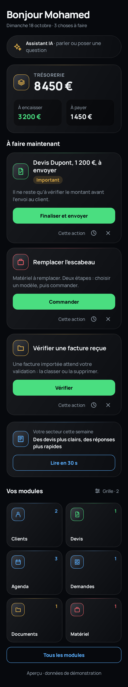
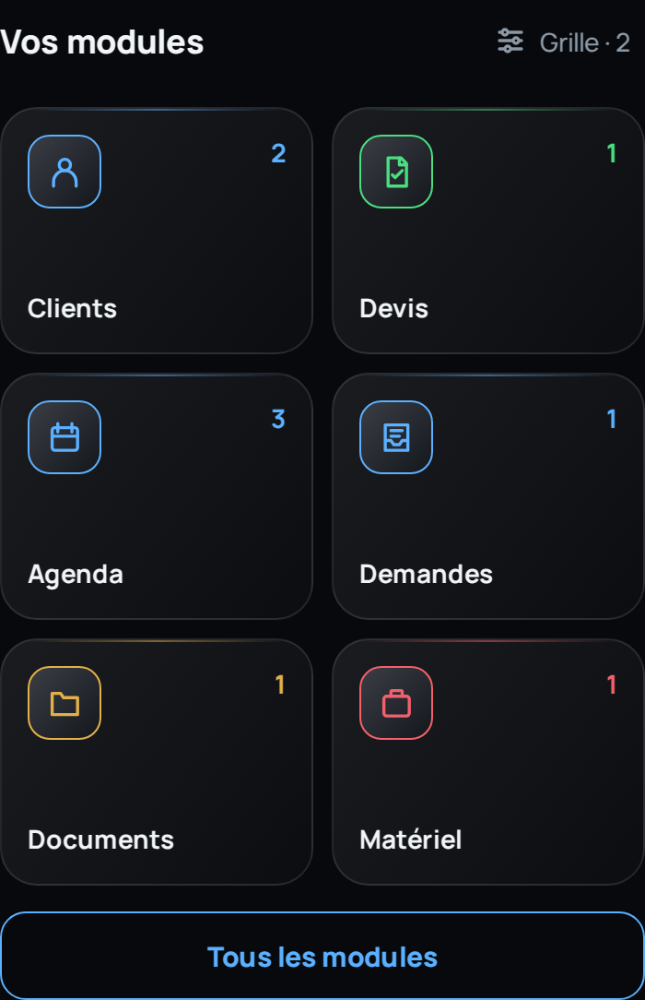
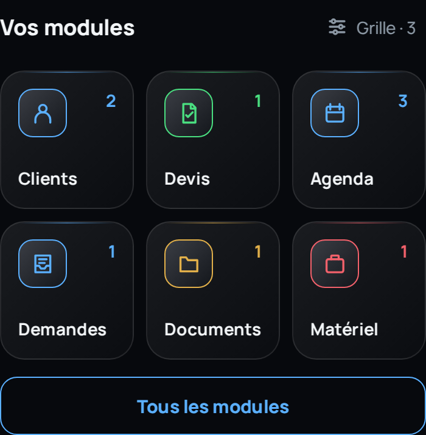
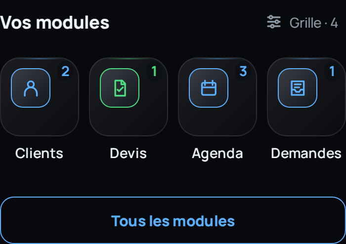

# Accueil mobile — Agence IA Studio

Prototype Expo / React Native en français. Étape 2 : données fictives, aucune opération métier réelle. Les couleurs, la police Manrope, les cartes en dégradé et les contours reprennent le brief du 18 octobre 2026. La grille propose 2, 3 ou 4 colonnes avec mémorisation locale et retour au réglage précédent.

## Aperçus



| Deux colonnes | Trois colonnes | Quatre colonnes |
|---|---|---|
|  |  |  |

## Essayer

```sh
cd mobile
npm ci
npm start
```

Le code utilise Expo SDK 58. Pour un appareil iPhone, utiliser une version compatible d’Expo Go ou une version de développement adaptée au SDK. La compatibilité sur un vrai iPhone et Android reste à vérifier. Pour un aperçu navigateur : `npm run web`.

## Périmètre

- Six blocs : salutation, assistant compact, trésorerie, trois actions maximum, veille, modules.
- Icônes SVG uniformes, couleurs sémantiques et composants séparés. Les valeurs de style sont regroupées dans `src/theme.ts`.
- La grille conserve des rangées complètes. En 4 colonnes, quatre des six modules apparaissent sur l’accueil ; les deux autres restent dans « Tous les modules ». Aucun module ne s’étire pour combler la place. Les compteurs nuls restent uniquement dans la liste complète avec recherche.
- La préférence actuelle et sa version précédente sont écrites ensemble sur l’appareil. Un échec de sauvegarde conserve le réglage actuel et affiche une erreur.
- Les boutons ouvrent des panneaux flottants au-dessus de l’accueil. Le défilement et le brouillon de l’assistant sont conservés pendant l’ouverture des panneaux.
- Les parcours de devis, de matériel et de document sont des simulations clairement annoncées. Aucun email n’est envoyé, aucun achat ni paiement n’est effectué.
- Les modules complets, les données réelles et les fonctions IA/vocales seront raccordés seulement après validation de l’étape 2. Les aperçus de documents sont textuels et fictifs.
- Boutons d’au moins 44 points, actions principales de 48 points, zones sûres iPhone, panneau limité à la hauteur disponible avec prise en compte du clavier.

## Sauvegarde et retour

L’application web et le serveur existants ne sont pas modifiés. Avant la création du prototype, la branche `backup/avant-accueil-mobile-2026-10-18` a été créée au commit `c919bda00f78f237a17223321c04127d80c84258`.

La branche `design/accueil-mobile-expo-2026-10-18` ajoute uniquement ce dossier `mobile/`. Pour comparer, consulter la branche sauvegardée ; pour annuler ce prototype, retirer seulement ce dossier. Éviter de réinitialiser une branche comportant des changements ultérieurs. Le fichier `BASELINE.json` consigne les références.

Dans l’application : **Vos modules → Grille → Revenir au réglage précédent**. Ce bouton rétablit la configuration locale précédente sans toucher aux données métier. Les actions de démonstration masquées peuvent être rétablies depuis le bas de l’accueil.

## Contrôles

```sh
npm run typecheck
npm run lint
npm run export:web
# Vérification des bundles natifs, sans installation sur appareil :
npx expo export --platform ios --platform android --output-dir dist-native
```

Le script `tests/ui.cjs` vérifie les préférences après rechargement, le retour arrière, les rangées complètes, les dimensions égales, la liste des modules masqués, la confirmation de simulation et les états vides. Pour l’exécuter, installer Playwright dans l’environnement de test, lancer `python -m http.server 8088 --directory dist`, puis `node tests/ui.cjs`.

Les tests navigateur et la compilation ne remplacent pas un essai sur un vrai iPhone. L’étape 5 (appareil réel et publication) reste ultérieure.
